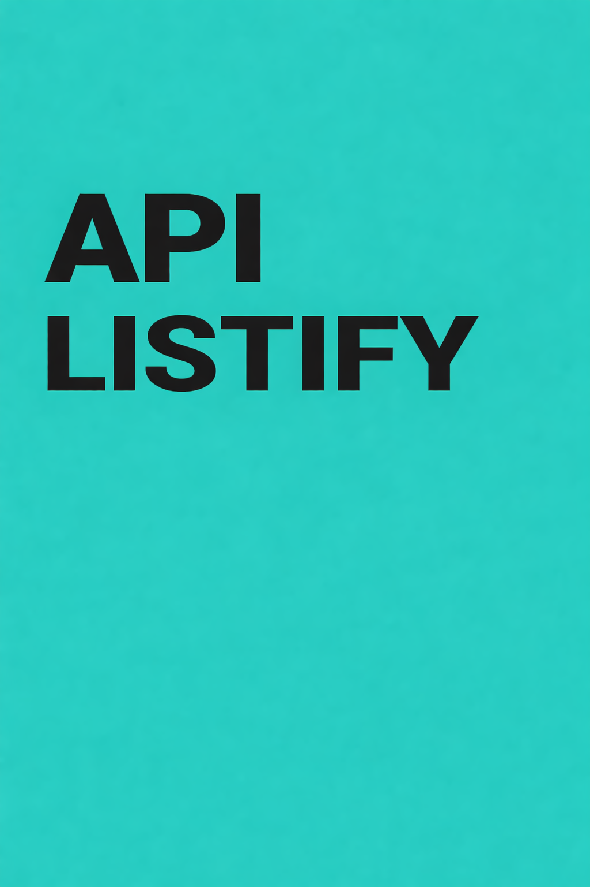

<p align="center"></p>

<h1 align="center">📚 ListiFy API</h1>

<p align="center"><em>API ASP.NET Core para gerenciar coleções pessoais.</em></p>

<p align="center">🇧🇷 Português | 🇺🇸 <a href="README.en.md">English</a></p>

<p align="center"> </p>

<p align="center"><a href="#sobre">Sobre</a> • <a href="#tecnologias">Tecnologias</a> • <a href="#como-rodar">Como rodar</a> • <a href="#licenca">Licença</a> • <a href="#autor">Autor</a></p>

---

<a id="sobre"></a>
## 📖 Sobre

Back-end para cadastro de usuários e itens de coleções, autenticação JWT, fotos e persistência relacional com Entity Framework Core e SQL Server.

## ✨ Funcionalidades

- Cadastro e autenticação de usuários
- Cadastro, consulta, edição e exclusão de itens
- Galeria de fotos dos itens
- Integração SMTP no cadastro

## 🛠️ Tecnologias

     

## 📦 Pré-requisitos

SDK .NET 8 e SQL Server. Configure localmente conexão com o banco, JWT e SMTP.

<a id="como-rodar"></a>
## 🚀 Como rodar

```bash
git clone https://github.com/Felipe-Amorim-Dev/ListiFy.Api.git
cd ListiFy.Api
dotnet restore Listify.sln
dotnet build Listify.sln
cd Listify.Services
dotnet run --launch-profile http
```

Swagger: http://localhost:5274/swagger

## 🔗 Repositórios relacionados

- [ListiFy.App](https://github.com/Felipe-Amorim-Dev/ListiFy.App) — Interface Angular 16

## 🏗️ Arquitetura e responsabilidades

- Listify.Services — controllers HTTP, modelos de entrada/saída, Swagger e composição de dependências
- Listify.Domain — entidades Usuario, Item e ItemFoto; interfaces e regras de negócio
- Listify.Infra.Data — DataContext, mapeamentos EF Core, migrações e repositórios SQL Server
- Listify.Security — geração de JWT com expiração configurável

### Fluxo de funcionamento

1. Angular → controllers ASP.NET Core → serviços de domínio → repositórios EF Core → SQL Server
2. Cadastro de itens recebe formulário e até cinco imagens; ItemFoto associa cada imagem ao item.
3. Autenticação consulta o usuário e utiliza TokenSecurity para emitir o token.

### Execução local

```bash
dotnet restore Listify.sln
dotnet build Listify.sln
cd Listify.Services
dotnet run --launch-profile http
```

Endereço do projeto: http://localhost:5274/swagger

<a id="licenca"></a>
## 📄 Licença

Distribuído sob a [licença MIT](LICENSE).

<a id="autor"></a>
## 👤 Autor

**Felipe Figueiredo Amorim** — Desenvolvedor Full Stack.

[](https://www.linkedin.com/in/felipe-amorim-dev/) [](mailto:felipe.f.amorim@outlook.com)

<p align="center"><strong>Obrigado por visitar! / Thanks for visiting!</strong></p>
